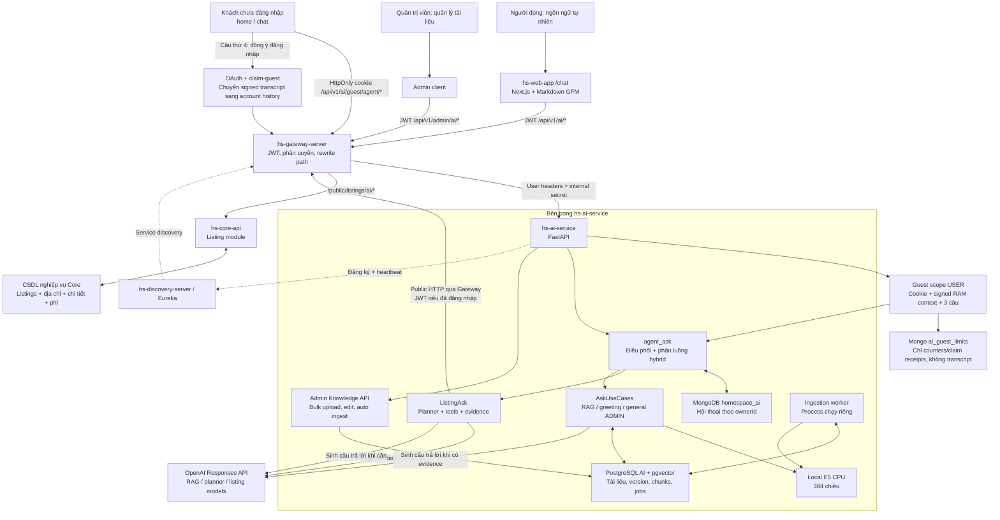
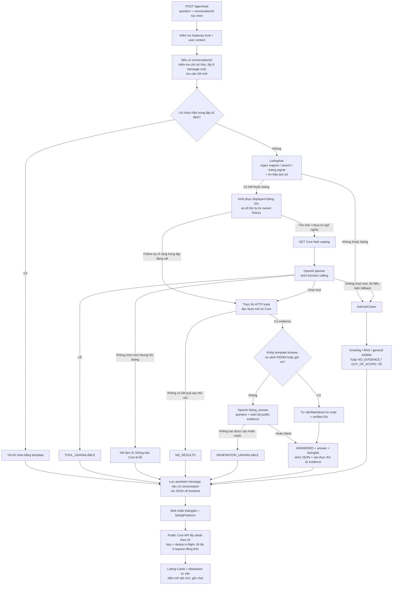
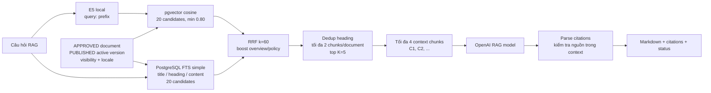
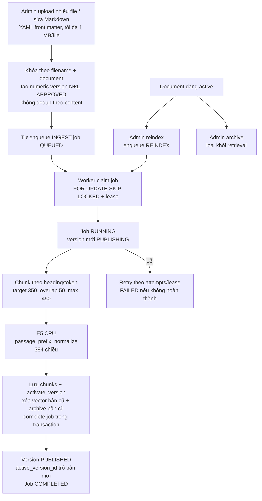

# HomeSpace AI — sơ đồ hệ thống và bộ nhớ context

## Cập nhật nhận nhà 21/10/2026

Core tách RESERVATION_DEPOSIT (cọc trước ngày nhận nhà) khỏi INITIAL (tiền tháng đầu), trường hợp nhận nhà ngay có thể gộp INITIAL cả hai. Contract AI financial trả thêm onboardingPayments có trạng thái từng khoản; không suy từ cọc CONFIRMED thành đã trả tháng đầu. Khi hai bên duyệt đề nghị bắt đầu sớm, ngày thuê và lịch hóa đơn đổi theo ngày mới. Dữ liệu luôn đọc lại Core. AI chỉ hỏi đáp, không gọi endpoint ghi của RentalOnboardingController. Nguồn RAG 06/07/08/13 đã cập nhật trên đĩa, cần Admin upload/apply để thay knowledge runtime. Xem hs-web-app/docs/RENTAL_ONBOARDING_TEST_CASES.md. Đồng hồ nghiệp vụ onboarding dùng BillingTime; bảo mật/SmartCA/token upload vẫn dùng giờ thực.

> Cập nhật: **11/10/2026**. Đối chiếu source code hiện có trong workspace, bao gồm thay đổi local chưa commit. Đây là tài liệu context bền vững của dự án, không phải xác nhận trạng thái triển khai production hay memory toàn cục của AI.
>
> Khi tiếp tục công việc, đọc file này trước, rồi đối chiếu lại code/config nếu chúng đã thay đổi. Không dùng các đề xuất kiến trúc cũ làm bằng chứng rằng một tính năng đã triển khai.

## 1. Các quyết định hiện tại cần giữ

- AI có hai nguồn dữ liệu độc lập: **tài liệu đã duyệt cho RAG** và **tin đăng công khai đọc trực tiếp qua Core API**.
- Người thuê có thể tìm phòng bằng ngôn ngữ tự nhiên, hỏi chi tiết và so sánh các tin thuộc `ROOM`, `APARTMENT`, `HOUSE`. Tiện ích và nội thất bàn giao là hai nhóm riêng, không được đánh đồng.
- AI service không kết nối trực tiếp CSDL nghiệp vụ của Core và không cho model tự viết/chạy SQL. Model chọn tool và tham số; Core kiểm tra rồi thực thi truy vấn có kiểm soát.
- Generation và native function calling dùng **OpenAI Responses API**. Không còn provider/fallback Gemini hoặc Groq trong luồng generation hiện tại.
- Embedding vẫn chạy local bằng E5 trên CPU; không chuyển tài liệu sang OpenAI embedding, không cần re-embed chỉ vì đổi model generation.
- Phân bổ model hiện tại ưu tiên tiết kiệm: RAG dùng `gpt-4o-mini`; planner và câu trả lời listing dùng `gpt-4.1-mini`.
- Giữ nguyên evidence công khai sau whitelist bảo vệ dữ liệu. Không bổ sung bước cắt field/compact JSON listing để giảm payload. Điều này **không có nghĩa** context/output/rate limit của provider là vô hạn.
- Chưa có tool truy vấn hợp đồng, thanh toán, hóa đơn hoặc lịch hẹn cá nhân; chưa có tool ghi dữ liệu nghiệp vụ.
- Admin RAG hỗ trợ upload nhiều file và sửa Markdown trên giao diện. Mỗi lần upload/lưu tạo version mới theo tên file, kể cả cùng nội dung; tự queue ingestion. Bản cũ chỉ bị xóa vector khi bản mới kích hoạt thành công; giữ metadata/lịch sử version.
- Không tự nâng model đắt hơn, không tự chạy test API trả phí, không commit/push secret. Những việc đó cần được đặt trong phạm vi yêu cầu riêng.
- Hỏi AI công khai không cần đăng nhập ở home và `/chat?channel=ai`. Lời chào là bong bóng local (có tên nếu đã đăng nhập), không gọi model và không đưa vào evidence/history backend.
- Phiên khách dùng session cookie `hs_ai_guest` HttpOnly, SameSite=Lax; owner `guest:<sha256>` tách biệt tài khoản. **Không lưu transcript khách vào Mongo**, không có danh sách lịch sử khách. Browser giữ transcript/context trong RAM khi đang chat; tải lại/đóng/rời khu vực chat sẽ mất. Mở trang chat từ Home là chuyển tiếp chủ động, có thể tiếp tục context trong cùng runtime.
- Guest được hỏi **3 câu**, không reset bằng refresh/chat mới. Backend dùng atomic counter trong `ai_guest_limits`, chỉ lưu metadata chống abuse (TTL 24 giờ), không lưu câu hỏi/trả lời. Context được AI ký HMAC bằng khóa purpose-derived từ `GATEWAY_INTERNAL_SECRET`, hết hạn sau `GUEST_CHAT_CONTEXT_TTL_SECONDS=3600`; gửi lại context hợp lệ cho follow-up, không tin transcript/tool facts do client tự tạo.
- Lượt thứ 4 mở modal đăng nhập, không gọi model. Chỉ khi chọn **Đăng nhập và tiếp tục**, browser giữ token context đã ký + câu hỏi đang chờ trong `sessionStorage` tối đa 20 phút qua OAuth redirect. Sau login, endpoint JWT `POST /agent/conversations/claim-guest` kiểm tra cookie/chữ ký/receipt rồi tạo owned account history một lần, giữ cả listing IDs/thứ tự/internal context. Xóa handoff sau thành công; câu hỏi thứ 4 được điền vào composer để người dùng gửi, không tự chạy paid request. Chuyển thất bại có nút thử lại; retry claim không nhân đôi history.
- Gateway chỉ mở `/api/v1/ai/guest/agent/**`; internal secret vẫn bắt buộc cho signed guest context, kể cả local. Guest luôn scope USER cho RAG, bỏ qua X-User-* giả mạo; account/admin/claim endpoints vẫn yêu cầu đăng nhập.
- POST khách (tạo hội thoại và hỏi) có quota Mongo atomic theo IP do Gateway cấp: mặc định 20/phút, 120/ngày; quá quota trả 429 + Retry-After. Đây không phải biện pháp chống bot hoàn chỉnh; khi public production cần cấu hình quota phù hợp, proxy IP tin cậy và có thể bổ sung CAPTCHA.

## 2. Sơ đồ tổng thể hiện tại



Gateway được dùng ở cả hai chiều: browser → AI và AI → Core. `PostgreSQL AI` chỉ lưu knowledge/ingestion, không phải CSDL listing. MongoDB lưu lịch sử chat, không phải kho facts realtime về listing.

## 3. Luồng một câu hỏi từ frontend đến câu trả lời



### Phân luồng thực tế, không phải router hoàn toàn do model

- `agent_ask.py` gọi `classify()` (`application/contract_context.py`) trước: nếu là câu hỏi hợp đồng cá nhân → `ContractAsk` (mục 9b), không đi qua regex “realtime/cá nhân → OUT_OF_SCOPE` và không bị lịch sử listing kéo sang nhánh Listing. Ngược lại mới thử `ListingAsk`, trừ lời chào chính xác.
- Câu hỗ trợ như “HomeSpace là gì”, “cách đăng tin”, “cách đặt lịch”, “cách thanh toán”, “điều khoản sử dụng” có nhánh regex ưu tiên RAG nếu không đồng thời có tín hiệu tìm kiếm.
- Follow-up rõ ràng (chọn phòng phù hợp/rẻ nhất, so sánh tập đang xét, phòng theo số thứ tự) dùng ID đã biết để đọc lại Core, bỏ qua catalog/planner. Câu tìm mới vẫn qua planner; câu hỏi ngữ nghĩa khác nhận thêm `DISPLAYED_SELECTION` ngoài text history để model định tuyến.
- Không chọn tool khác với lỗi API: hỏi làm rõ khi cần, không dùng RAG bịa facts listing. Log `listing_plan_missing` hoặc `listing_request_failed` kèm request_id/stage/error_type/http_status; không log prompt, token, body hay hội thoại.
- Prompt cho phép suy luận, xếp hạng và tính toán từ facts mới. N người cần sức chứa >=N; không so sánh tiền thuê như tổng chi phí nếu thiếu điện/nước/phí. Nhu cầu hiện tại ưu tiên hơn nhu cầu cũ; recommendation hỏi gửi xe không bị template chỉ trả phí chiếm mất.
- Phân luồng còn phụ thuộc regex và cách diễn đạt; không được gọi đây là phân loại intent đảm bảo đúng cho mọi câu tiếng Việt.
- `GENERATION_PROVIDER=disabled` dùng disabled client: không có OpenAI generation thành công; RAG có thể retrieval nhưng trả trạng thái gián đoạn khi cần sinh đáp án.

### Contract trả về frontend

Gateway endpoint: `POST /api/v1/ai/agent/ask`; endpoint bên trong AI: `POST /agent/ask`.

Khách dùng `POST /api/v1/ai/guest/agent/ask` → `/guest/agent/ask`, thêm `guestState` đã ký và `conversationId` từ guest bootstrap; response thêm `guestState` mới và `remainingQuestions`. Không có API đọc/xóa/ghim guest transcript; GET list trả rỗng. Browser gửi credentials cho bootstrap/ask và authenticated claim. Gateway CORS phải cho phép origin frontend cụ thể + credentials; frontend/gateway cần cùng site để cookie SameSite=Lax hoạt động. Gateway bỏ header IP client gửi và cấp IP peer (sau reverse proxy có thể là IP proxy; không tin X-Forwarded-For chưa kiểm chứng). Downstream không JWT chỉ trong public listing AI; API khác vẫn cần token.

```json
{
  "question": "Tìm phòng trọ ở Phú Lợi có ban công và chỗ gửi xe máy",
  "conversationId": "<conversation-id>"
}
```

`question` tối đa 1.000 ký tự; backend cũng nhận alias `query`. `conversationId` có thể bỏ để hỏi stateless; alias backend là `conversation_id`.

```json
{
  "code": 1000,
  "result": {
    "answer": "<Markdown câu trả lời>",
    "status": "ANSWERED",
    "citations": [],
    "requestId": "<request-id>",
    "listingIds": ["<verified-listing-uuid>"],
    "listingPositions": {"<verified-listing-uuid>": 3}
  }
}
```

| Status | Ý nghĩa |
| --- | --- |
| `ANSWERED` | Có đáp án: greeting, listing hoặc RAG |
| `GENERAL_ANSWER` | Câu trả lời kiến thức chung dành cho ADMIN, không có nguồn HomeSpace |
| `NO_RESULTS` | Tìm listing không có kết quả phù hợp sau các bước hiện có |
| `NO_EVIDENCE` | RAG không có evidence phù hợp/đủ để trả lời |
| `OUT_OF_SCOPE` | Yêu cầu dữ liệu cá nhân/realtime ngoài các tools đang hỗ trợ |
| `LOGIN_REQUIRED` | Hỏi hợp đồng cá nhân nhưng chưa đăng nhập (khách) hoặc Core trả 401 |
| `NEEDS_CLARIFICATION` | Nhiều hợp đồng phù hợp (“hợp đồng hiện tại” mơ hồ): trả danh sách ngắn để chọn |
| `NOT_FOUND` | Hợp đồng không tồn tại hoặc không thuộc tài khoản (cùng một phản hồi cho cả hai) |
| `TOOL_UNAVAILABLE` | Không lập/thực thi được kế hoạch listing đáng tin cậy |
| `GENERATION_UNAVAILABLE` | Có thể đã lấy được dữ liệu nhưng không tạo được đáp án hoàn chỉnh |

Không dùng “không có phòng” để thay cho lỗi provider/tool. Các lỗi HTTP xác thực, validation, conversation không tồn tại vẫn có thể xảy ra ngoài các status nghiệp vụ trên.

Frontend hiện nhận **một JSON hoàn chỉnh**, chưa dùng SSE/token streaming. `AiMarkdownMessage.tsx` dùng `react-markdown` + `remark-gfm`, hỗ trợ table cuộn ngang, không bật raw HTML. Listing cards được render riêng bằng `AiListingCards` + `AiListingCompactCard`, không do model dựng HTML/link/facts. Card chat dạng hàng ngang một cột: số thứ tự, tiêu đề, giá đúng đơn vị, loại hình, diện tích, sức chứa/số phòng ngủ khi có và phường/tỉnh. Không có ảnh lớn, owner/footer, favorite hay lượt xem; skeleton cũng nhỏ. Không đổi card ở trang rent. Ảnh bìa thumbnail bên trái (80px mobile/112px desktop), nội dung bên phải; ưu tiên media IMAGE có cover=true rồi sortOrder. Chỉ một ảnh, lazy-load; thiếu/lỗi ảnh dùng placeholder, không lấy VIDEO làm ảnh bìa.

`listingIds` là các tin cần hiển thị (đề xuất một phòng có thể chỉ trả một ID), khác internal scope của toàn nhóm. `listingPositions` giữ số thứ tự gốc để card của Phòng 3 không bị đổi thành Phòng 1. RAG/no-results/lỗi trả IDs rỗng. Generated answers dùng OpenAI strict Structured Outputs, enum IDs từ evidence mới và application kiểm tra lần nữa. Không phát sinh paid call riêng để chọn ID. Browse/ROOM comparison/parking templates không gọi model.

Web gọi `GET /api/v1/public/listings/{id}` qua Gateway, chỉ hiển thị PUBLISHED + active + chưa hết hạn, không gọi API ghi nhận view khi hydrate. Lazy-load khi gần viewport, gộp request trùng đang chạy và tối đa 3 request đồng thời; không cache facts sau khi mở lại lịch sử. Tin không còn public có placeholder; lỗi mạng có nút thử lại, không xóa tư vấn. Card và link legacy mở tab mới (`target=_blank`, `noopener noreferrer`, tắt prefetch), không redirect chat. ID/position lưu cùng assistant message; lịch sử mới mở lại vẫn có thẻ. Lịch sử cũ chưa có field này vẫn dùng Markdown, không cần migration.

## 4. Tool calling listing và truy vấn realtime

```mermaid
sequenceDiagram
    participant W as Web app
    participant G as Gateway
    participant A as AI service
    participant O as OpenAI planner
    participant C as Core listing API
    participant D as Core database
    W->>G: POST /api/v1/ai/agent/ask + JWT
    G->>A: POST /agent/ask + trusted user headers
    A->>G: GET /api/v1/public/listings/ai/fields + JWT gốc
    G->>C: GET /public/listings/ai/fields
    C-->>A: Field registry và kiểu dữ liệu
    A->>O: Question + history + strict tool schema
    O-->>A: Một function_call hoặc không gọi tool
    A->>G: POST /api/v1/public/listings/ai/search
    G->>C: Filters whitelist + sort + limit
    C->>D: Parameterized SQL, chỉ tin công khai hợp lệ
    D-->>C: Count + IDs trong transaction tìm kiếm
    C-->>A: listingIds + total + readAt
    loop Tối đa 5 IDs, đọc tuần tự
        A->>G: GET /api/v1/public/listings/ai/UUID
        G->>C: Đọc chi tiết công khai
        C->>D: Lấy facts listing
        D-->>C: Facts
        C-->>A: Listing detail
    end
    Note over A,O: Template có thể trả trực tiếp;<br/>các câu khác gọi model listing với evidence
    A-->>W: Qua Gateway: Markdown + status + requestId
```

Đây là sequence cho tìm kiếm. Với follow-up rõ ràng/UUID và số thứ tự đã biết từ selection, code đọc detail trực tiếp, không cần planner hoặc search. Với câu ngữ nghĩa chưa rõ, planner nhận ID/thứ tự riêng rồi chọn detail hoặc search; không được tự tạo UUID mới.

### Tool model được phép chọn

| Native function | Gateway Core endpoint | Chức năng |
| --- | --- | --- |
| Catalog do code lấy khi cần planner | `GET /api/v1/public/listings/ai/fields` | Danh sách field filter hợp lệ và kiểu dữ liệu |
| `search_listings` | `POST /api/v1/public/listings/ai/search` | Tìm theo filters, sort, limit |
| `get_listing_detail` | `GET /api/v1/public/listings/ai/{listingId}` | Đọc một UUID đã biết |
| `get_listing_details` | Lặp endpoint detail | Đọc 2–5 UUID để so sánh |

Không có MCP server/client trong luồng đang chạy: đây là **native OpenAI function calling + HTTP adapter**. Không mô tả module cũ `property_search` là endpoint đang dùng.

Planner dùng `strict=true`, `additionalProperties=false`, enum field lấy từ Core; `tool_choice=auto`, `parallel_tool_calls=false`. Mỗi lượt chọn tối đa **một function**, không phải agent vòng lặp tự chủ nhiều bước. Code orchestration tự mở rộng search thành nhiều detail requests.

### Quy tắc filter / SQL tại Core

- `filters`: tối đa 24 điều kiện, kết hợp bằng **AND**. Chưa có cây OR/nested expression.
- Các operator: `eq`, `ne`, `gt`, `gte`, `lt`, `lte`, `contains`; Core giới hạn operator theo kiểu, không phải field nào cũng dùng được cả bảy.
- Value planner gửi dạng string; Core chuyển sang text/number/integer/boolean/date, không nhận null filter. `contains` dùng text LIKE đã escape wildcard.
- Sort: `newest`, `price_asc`, `price_desc`, `area_asc`, `area_desc`.
- AI giới hạn kết quả tối đa 5; Core API cho limit 1–10. `total` là tổng match, không phải số detail được đưa vào đáp án.
- Core search bắt buộc `active=true`, `status=PUBLISHED`, chưa hết hạn; detail kiểm tra publication/expiry, AI kiểm tra thêm active và status.
- Identifier SQL chỉ từ registry cố định; giá trị bind bằng `NamedParameterJdbcTemplate`. Bảng quan hệ được lọc qua `EXISTS`/`NOT EXISTS`.
- Count và IDs của **một search** chạy read-only `REPEATABLE_READ`; các HTTP detail đọc sau đó không cùng transaction snapshot.
- Thiếu field không được tự coi là `false`, `0`, miễn phí hoặc không có. Query SQL null không có nghĩa phủ định.

### Phạm vi field tìm kiếm hiện có

| Nhóm | Field/nhóm field được registry hỗ trợ |
| --- | --- |
| Chung | ID, title, description, category; giá/đơn vị/tiền tệ; diện tích; đặt cọc; chu kỳ thanh toán; thuê tối thiểu; thương lượng; VAT/phí quản lý đã gồm; số xe; ngày nhận/publish/hết hạn; lượt xem |
| Địa chỉ | `city_id`, `city`, `ward_id`, `ward`, `street`, `display` từ `listing_addresses`; dùng mã Vietmap admin_new. Không có field `district_*` trong registry hiện tại |
| `house.*` | Đất, mặt tiền/chiều dài/đường vào, số mặt tiền/tầng/phòng, sân thượng, garage, lối đi, nội thất tổng quát, pháp lý, sức chứa người/xe, phạm vi/tầng cho thuê |
| `apartment.*` | Dự án, block, mã căn, tầng/tổng tầng, số phòng, nội thất tổng quát, hướng cửa/ban công, view, sức chứa, pháp lý |
| `room.*` | Mã/tầng, WC/bếp, cửa sổ/ban công/gác, nội thất tổng quát, lối đi/giờ ra vào, đồng hồ điện/nước, sức chứa người/xe, chính sách gửi xe |
| `charge.TYPE.*` | Amount, included_in_rent, billing_method, unit, description, custom_name theo loại khoản phí |
| `amenity.*` | Boolean theo các mã cố định; `amenity.code` hỗ trợ eq/ne theo mã |
| `custom_amenity.name` | Tên tiện ích tùy chỉnh |
| `furnishing.CODE.*` | Có món đồ, số lượng, tình trạng bàn giao, tên, ghi chú theo các mã cố định; cũng có `furnishing.item_code/asset_name` |
| `media.IMAGE/VIDEO` | Kiểm tra tồn tại ảnh/video |
| `viewing.day_of_week/viewing_slot` | Ngày và khung tiếp khách của tin; không phải booking cá nhân hay số lượt đặt lịch |

Nguồn chính xác của toàn bộ registry: `hs-core-api/hs-listing-service/.../AiListingSearchService.java`. Không phải mọi nội dung trả trong detail đều có filter riêng; thêm field mới cần đồng bộ registry, DTO, planner và test.

Loại phí: `ELECTRICITY`, `WATER`, `MANAGEMENT`, `INTERNET`, `SERVICE_OR_GARBAGE`, `MOTORBIKE_PARKING`, `CAR_PARKING`, `OVERTIME_AIR_CONDITIONING`, `OTHER`.

Tiện ích boolean cố định: `WIFI`, `AIR_CONDITIONER`, `WATER_HEATER`, `REFRIGERATOR`, `WASHING_MACHINE`, `ELEVATOR`, `PARKING`, `SECURITY_24_7`, `CAMERA`, `SWIMMING_POOL`, `GYM`.

Thú cưng/hút thuốc/cho thuê lại/khách qua đêm là chính sách, không phải amenity. Dùng `policy.petPolicy.value`, `policy.smokingPolicy.value`, `policy.subleasePolicy.value`, `policy.overnightGuestPolicy.value` với `ALLOWED`, `NOT_ALLOWED`, `APPROVAL_REQUIRED`. “Cho phép” chỉ là ALLOWED; cần chủ nhà chấp thuận không đồng nghĩa đã cho phép. Các filter được scope cùng policy_code để không nhầm quyền của dòng khác. Nội dung bổ sung tra `.note`; các chính sách TEXT theo loại hình dùng `policy.buildingRulesPolicy.value`, `policy.sharedAmenitiesPolicy.value`, `policy.quietHoursPolicy.value`. Registry Core là nguồn field có thẩm quyền, không tự thêm field ngoài registry.

Nội thất theo mã: `BED`, `WARDROBE`, `WORK_DESK`, `KITCHEN_SHELF`, `REFRIGERATOR`, `WASHING_MACHINE`, `WATER_HEATER`, `CURTAIN`, `FAN`, `SOFA_SET`, `DINING_SET`, `TV`, `KITCHEN_CABINET`, `COOKTOP`, `AIR_CONDITIONER`, `LIGHTING`.

### Evidence, gợi ý gần đúng và response

- `ListingTools.detail` whitelist: ID/title/description/category/status; availableFrom/area/số xe; pricing; house/apartment/room detail; amenities/customAmenities; furnishings; charges; address; viewingDays/Slots; publishedAt/expiresAt/viewCount. Media chỉ đưa số ảnh/video.
- Không đưa owner identity, audit/moderation nội bộ hoặc nội dung media đầy đủ vào model.
- Search không có IDs: thử bỏ **một** điều kiện mỗi lần, từ cuối danh sách. Không tự bỏ category hoặc province/ward code/name; dừng ở lần đầu tìm được kết quả. Chưa có geospatial/semantic nearest-match ranking.
- Có nới điều kiện thì response phải ghi rõ `relaxedFilters`, không gọi gợi ý đó là khớp đầy đủ.
- Một số câu browse, so sánh ROOM tổng quát và hỏi gửi xe có template deterministic. Câu hỏi cụ thể khác dùng listing model với JSON evidence không compact.
- Browse template còn kiểm tra câu bắt đầu “Tìm”, “Kiếm”, “Cho tôi/mình xem”; cách diễn đạt “Tôi cần tìm…” có thể dùng generation thay vì template. Không nhầm điều này với thiếu dữ liệu search.
- Chính sách ROOM `NONE/FREE/PAID`, sức chứa xe và khoản `MOTORBIKE_PARKING` là các facts khác nhau. “Có chỗ gửi xe” không đồng nghĩa “miễn phí”; “includedInRent” không đồng nghĩa khoản phí không tồn tại.
- Listing response trả ID cho web render cards, không dùng citations RAG và không bổ sung danh sách link Markdown. Model chỉ viết tư vấn/so sánh; không lặp toàn bộ card facts. Input evidence vẫn đầy đủ, tiết kiệm ở phần output trình bày.

## 5. RAG: retrieval và tài liệu đã duyệt



- USER chỉ retrieval `visibility=public`; ADMIN thêm `admin`. `audience` là metadata, không thay thế kiểm soát visibility theo role.
- Chỉ version active được retrieval; bản draft/approved chưa publish không phải evidence sử dụng để trả lời.
- `RETRIEVAL_MIN_SIMILARITY=0.80` áp dụng vector branch; lexical candidates vẫn có thể được đưa vào hợp nhất. Không hiểu 0.80 là ngưỡng loại mọi kết quả hybrid.
- Vector query là exact cosine search trong code; không mặc định tuyên bố đã có HNSW/ANN index.
- Lời chào có template. ADMIN được hỏi chủ đề chung nếu không nhận diện là HomeSpace; nhánh này không có web browsing/tool kiểm chứng realtime.
- Yêu cầu trạng thái hợp đồng/hóa đơn/lịch hẹn/tài khoản riêng chưa có tool được trả `OUT_OF_SCOPE` theo heuristic hiện có.
- Model được yêu cầu đánh dấu nguồn `[C1]...`; code kiểm tra citation ID thuộc context và trả documentId/version/title/heading/chunkId. Có heuristic fallback khi thiếu marker, nên chưa phải kiểm chứng từng claim bằng entailment.
- Ask API hiện dựng `CitationItem` không truyền snippet từ fallback; đừng dựa vào snippet để frontend chắc chắn có đoạn trích khi generation lỗi.
- RAG chưa dùng lịch sử hội thoại làm context generation, dù endpoint có nhận conversationId và lưu messages.

## 6. Nạp tài liệu và lưu trữ



Worker là **process riêng**, API không tự chạy ingestion loop. Job polling mặc định 2 giây, lease 60 giây, tối đa 3 attempts; có heartbeat/thu hồi job RUNNING bị mất lease. Reindex chỉ chấp nhận document đang active và embedding identity phù hợp.

Publish bản mới không loại bản active cũ trước khi nạp thành công. Nếu đổi model/revision embedding, quy trình hiện tại yêu cầu upload version phù hợp; không trộn vectors khác identity.

Tên file chuẩn hóa NFC/casefold là identity; `document_id/version` trong front matter không quyết định identity/số version. Migration giữ document ID cũ và đánh số lại version 1, 2, ... theo thứ tự tạo. Editor gửi `expectedVersionId` để tránh lost update (409 nếu bản đã thay đổi). Upload batch tối đa 50 file; kết quả/lỗi độc lập từng file. README bị bỏ qua. Chỉ Admin được upload/sửa; thao tác upload/apply là chấp thuận ingest, không dựa vào `status` trong Markdown. Các route approve/publish giữ cho draft cũ/retry. Cặp worker out-of-order được kiểm tra bằng version_number trước activation; bản xử lý cũ không rollback bản active mới.

### PostgreSQL AI — bảng chính

| Bảng | Vai trò |
| --- | --- |
| `knowledge_documents` | Logical document ID, source_filename unique, metadata, visibility, status, active_version_id |
| `knowledge_document_versions` | Raw Markdown, numeric version_number unique theo document, version, hash, embedding identity, config và lifecycle |
| `knowledge_chunks` | Content, heading, metadata, chunk index/token count, vector 384 |
| `knowledge_ingestion_jobs` | INGEST/REINDEX, status, attempts, lease, worker, error |
| `worker_heartbeats` | Worker registry và heartbeat phục vụ chẩn đoán |

Version liên kết document qua `document_id`; chunks/jobs có FK tới version. `active_version_id` là tham chiếu logical ở model hiện tại, không khai báo FK tại cột này trong ORM. Không thêm quan hệ ràng buộc CSDL vào sơ đồ nếu chưa đối chiếu migration.

### MongoDB — hội thoại và giới hạn memory runtime

Collection: `ai_conversations`, database mặc định `homespace_ai`.

```text
conversation
├── _id, ownerId, title, isPinned, createdAt, updatedAt
└── messages[]
    └── id, role, content, status, createdAt, listingIds[], listingPositions{}, listingContext? {version, listingIds[]}
```

- Đọc/sửa/pin/xóa đều scope theo `ownerId`; index hiện có `ownerId + updatedAt`.
- Lượt hỏi lấy 8 messages trước đó cùng internal `listingContext`. Planner cắt text mỗi message tối đa 1.200 ký tự, nhưng ID/thứ tự được truyền riêng, không mất do cắt text.
- `listingContext` của assistant chỉ lưu ID/thứ tự scope đang xét, không lưu giá/facts realtime và không expose frontend. `listingIds`/`listingPositions` public lưu riêng cho các thẻ của message; đề xuất một tin không làm mất scope cả nhóm. Browse hiển thị 4/5 tin thì context chỉ có 4 tin. Câu legacy chưa có state khôi phục ID từ toàn bộ Markdown assistant trước truncation; không dùng link user để tự tạo selection.
- Hỏi riêng phòng 3 không đổi số thứ tự toàn tập; đổi tìm kiếm tạo tập mới. Trả lời RAG thành công hoặc tìm không có kết quả xóa scope; lỗi tạm thời không xóa scope. Facts luôn đọc lại Core và tin không còn công khai không được dùng dữ liệu cũ để tư vấn. Không có lưu filter/nhu cầu có cấu trúc dài hạn: model nhận các yêu cầu user gần đây và câu hiện tại. Chưa serialize các lượt hỏi đồng thời.
- Account messages array chưa có TTL/giới hạn tổng kích thước. TTL index trên `ai_conversations.expiresAt` chỉ dọn legacy guest history; code mới từ chối persist owner `guest:`. `ai_guest_limits` chứa quota IP, trial count/activeSession và claim owner receipt, không chứa transcript. Các lượt guest được reserve atomically, stale/replayed/concurrent context bị chặn trước model.
- File `SCHEMA-SYSTEM.md` này là **memory context cho kỹ sư/AI coding agent**, không phải collection chat hay nguồn facts listing của trợ lý người thuê.

## 7. Model, payload và chi phí

Các giá trị dưới đây đã đối chiếu `.env` local và defaults config ngày cập nhật; **không chứa key**.

| Tác vụ | Biến model | Model hiện tại | Output budget mặc định |
| --- | --- | --- | --- |
| RAG + general ADMIN | `OPENAI_RAG_MODEL` | `gpt-4o-mini` | `OPENAI_RAG_MAX_OUTPUT_TOKENS=4096` |
| Chọn tool / filters | `OPENAI_TOOL_MODEL` | `gpt-4.1-mini` | `OPENAI_TOOL_MAX_OUTPUT_TOKENS=4096` |
| Đáp án listing / so sánh | `OPENAI_LISTING_MODEL` | `gpt-4.1-mini` | `OPENAI_LISTING_MAX_OUTPUT_TOKENS=16384` |
| Embedding tài liệu/query | `EMBEDDING_MODEL_ID` | `intfloat/multilingual-e5-small` local | Vector 384; không gọi OpenAI embedding |

- Provider local: `GENERATION_PROVIDER=openai`. Nếu không khai báo, Settings mặc định `disabled`.
- `GENERATION_TEMPERATURE=0.2`, `GENERATION_TIMEOUT_SECONDS=90`; reasoning effort chỉ gửi cho các prefix reasoning model mà transport nhận diện. Các model mặc định hiện tại không gửi reasoning parameter.
- Embedding revision pinned: `614241f622f53c4eeff9890bdc4f31cfecc418b3`; cache mặc định `./models_cache`.
- Không có output budget đồng nghĩa input payload cap. Listing evidence không bị compact, nhưng số tin/historical messages vẫn bị giới hạn như các mục trên.
- Lượt RAG thông thường có một generation request nếu có evidence. Listing có planner request và có thể thêm listing generation; template giảm được lần generation thứ hai. Listing support bị router loại trước planner không tốn planner call.
- Lỗi mạng và HTTP 408/409/429/500/502/503/504 retry tối đa một lần ở transport; `insufficient_quota`, lỗi auth/invalid request không retry theo nhánh transient. Retry có thể tăng thời gian và chi phí.
- Generation gặp `incomplete/max_output_tokens` thử lại một lần với budget gấp đôi, trần code 32.768. Nếu vẫn lỗi thì trả `GENERATION_UNAVAILABLE`, không trả đáp án bị cắt.
- Trần retry là trần code, không đảm bảo mọi model chấp nhận. Khi đổi model phải kiểm tra output/context limit của model; retry generation và retry transport là hai lớp riêng.
- Không có fallback sang model đắt hơn/provider khác. Chưa có cost accounting/quota theo tài khoản đăng nhập; phiên khách có quota POST theo IP do Gateway cấp.
- Log `openai_usage`: task, model, input/output/cached/reasoning tokens, response status, provider request ID. Theo dõi spend bằng usage thực tế, không suy ra giá mỗi lượt chỉ từ số câu hỏi hay balance hiển thị làm tròn.
- Requests dùng `store=false`; không được diễn giải thành cam kết zero data retention cho mọi cơ chế phía provider.

## 8. Xác thực, secrets và operational boundaries

- Frontend dùng JWT qua Gateway cho tài khoản; phiên khách dùng cookie HttpOnly trong guest namespace. Không giữ `OPENAI_API_KEY` trong frontend và không gọi OpenAI trực tiếp.
- Gateway xóa các user/internal headers từ request bên ngoài rồi gắn lại user context đã xác thực. AI routes nhận thêm `X-Internal-Secret`.
- AI dùng shared `GATEWAY_INTERNAL_SECRET` để xác minh trust trước khi tin `X-User-*`; agent/admin routes tài khoản yêu cầu user ID. Guest routes cũng kiểm tra Gateway trust nhưng lấy owner từ cookie và luôn scope USER. Môi trường không-local yêu cầu secret hợp lệ; local không cấu hình secret hiện có nhánh bỏ qua trust guard. Không dùng ngoại lệ local này cho triển khai public.
- AI → Core chuyển tiếp **Authorization JWT gốc** nếu có, không sao chép arbitrary user headers/cookie. Khách chỉ gọi namespace `/api/v1/public/listings/ai`; các path khác vẫn cần JWT. Gateway client chỉ cho `/api/v1/*`, chặn `/api/v1/ai/*` để tránh gọi vòng.
- `.env` và `.env.*` bị gitignore, ngoại trừ `.env.example`; key dùng `SecretStr`, không chép vào doc/example/tests/frontend. Không overwrite `.env` đang có bằng file example khi chạy lại.
- Transport OpenAI không log key, headers, prompt, tool bodies hay provider error bodies. **Tuy nhiên** validation error handler trong `main.py` hiện log raw request body; không được tuyên bố toàn service đã loại hết dữ liệu khách hàng khỏi log. Đây là điểm cần rà riêng trước production.
- Facts listing lấy lại ở mỗi câu hỏi có tool, không cache facts trong vector database. “Realtime” ở đây là đọc lúc request, không phải subscription, push updates hay snapshot nguyên tử của cả hội thoại.

## 9. API và bản đồ source code để tiếp tục công việc

| Qua Gateway | Trong AI service | Mục đích |
| --- | --- | --- |
| `/api/v1/ai/agent/ask` | `/agent/ask` | Endpoint hỏi đáp thống nhất |
| `/api/v1/ai/agent/conversations` | `/agent/conversations` | GET list, POST create |
| `/api/v1/ai/agent/conversations/{id}` | `/agent/conversations/{id}` | GET detail, DELETE |
| `/api/v1/ai/agent/conversations/{id}/pin` | `/agent/conversations/{id}/pin` | PATCH pin |
| `/api/v1/ai/guest/agent/ask` | `/guest/agent/ask` | Guest RAG/listing, cookie ownership, quota |
| `/api/v1/ai/guest/agent/conversations` | `/guest/agent/conversations` | GET list rỗng / POST bootstrap signed context, không lưu history |
| `/api/v1/ai/agent/conversations/claim-guest` | `/agent/conversations/claim-guest` | JWT + cookie + signed state: chuyển guest transcript vào tài khoản một lần |
| `/api/v1/admin/ai/knowledge/*` | `/admin/knowledge/*` | Admin knowledge API |

Knowledge routes gồm documents CRUD được hỗ trợ, approve/publish/reindex/archive, jobs/{id}, worker-health, search diagnostic, test-ask. `test-ask` có thể dùng generation và phát sinh phí khi provider bật; không gọi tự động chỉ để đọc context.

Admin upload nhiều file: `POST /api/v1/admin/ai/knowledge/documents/batch` (multipart `files[]`, 202). Mở/sửa file: `GET/PUT /api/v1/admin/ai/knowledge/documents/{id}/content`; PUT body gồm `markdown` và `expectedVersionId`, trả version/jobId mới để poll. Không đổi frontend user chat hay contract tool calling listing.

| File/module | Trách nhiệm |
| --- | --- |
| `src/homespace_ai/main.py` | Lifespan, preload E5, Mongo init, Eureka, health endpoints |
| `src/homespace_ai/core/config.py` | Settings/env, model allocation, budgets, retrieval/worker defaults |
| `src/homespace_ai/core/security.py` | Gateway trust, user context, require_admin |
| `src/homespace_ai/api/v1/agent_ask.py` | Contract hỏi đáp, owned history, điều phối hai nhánh |
| `src/homespace_ai/api/v1/schemas.py` | Request/response, citations, conversations |
| `src/homespace_ai/application/use_cases/listing_ask.py` | Orchestration listing, relaxation, templates, generation |
| `src/homespace_ai/clients/listing_tool_planner.py` | Strict OpenAI native tools và normalization heuristic |
| `src/homespace_ai/tools/listings.py` | Core HTTP tools, UUID/public checks, whitelist evidence |
| `src/homespace_ai/clients/gateway.py` | Gọi Gateway bằng caller JWT, path guard, timeout |
| `src/homespace_ai/clients/generative.py` | Responses transport, task model, safe usage logging, retries |
| `src/homespace_ai/application/use_cases/ask_use_cases.py` | RAG/general/greeting/out-of-scope, citations |
| `src/homespace_ai/repositories/chunk_repo.py` | Vector/lexical retrieval, ACL, RRF/diversity |
| `src/homespace_ai/api/v1/admin_knowledge.py` | Admin endpoints và diagnostics |
| `src/homespace_ai/application/use_cases/document_use_cases.py` | Upload/approve/publish/reindex/archive lifecycle |
| `src/homespace_ai/knowledge/ingestion/worker.py` | Background process xử lý jobs |
| `src/homespace_ai/knowledge/ingestion/parser.py` | Markdown UTF-8 + YAML front matter validation |
| `src/homespace_ai/models/knowledge.py` | ORM knowledge/jobs/worker models |
| `src/homespace_ai/repositories/conversation_repo.py` | Mongo conversations ownership và messages |
| `src/homespace_ai/repositories/job_repo.py` | Lease/claim/retry jobs |
| `scripts/smoke_openai.py` | Smoke test provider opt-in, không phải Core E2E |

Các repo liên quan, tính từ `D:/Workspace/homespace/`:

- `hs-web-app/services/ai.service.ts`: HTTP agent/conversation client.
- `hs-web-app/app/chat/page.tsx`: gửi câu hỏi qua `aiService.ask`.
- `hs-web-app/components/chat/AiMarkdownMessage.tsx`: render Markdown/table/link.
- `hs-gateway-server/src/main/java/com/hs/gateway/HsGatewayServerApplication.java`: AI/admin/Core routes và rewrite prefixes.
- `hs-gateway-server/src/main/java/com/hs/gateway/filter/UserHeaderFilter.java`: sanitize/trusted headers.
- `hs-core-api/hs-api-service/src/main/java/com/hs/api/controller/publish/PublicListingController.java`: public AI field/search/detail endpoints.
- `hs-core-api/hs-listing-service/src/main/java/com/hs/listing/service/AiListingSearchService.java`: whitelist fields, parameterized search.
- `hs-infra/postgres/`: seed fixtures; chỉ là dữ liệu để đối chiếu test, không thay thế CSDL đang chạy.

Thứ tự ưu tiên khi thông tin mâu thuẫn: **source/config đang dùng → migration/contracts/tests → tài liệu context này → README/đề xuất cũ**.

## 9b. Nguồn thứ ba: hợp đồng của tài khoản (chỉ đọc)

**Ba nguồn tách biệt:** RAG (kiến thức chung, public/admin ACL), Listing tools (tin công khai), Contract tools (hợp đồng của chính tài khoản đăng nhập). Câu kết hợp (“có thể gia hạn lúc này không, làm thế nào?”) = Contract + RAG: phần cá nhân từ Core, phần hướng dẫn chung từ RAG, trình bày thành hai mục có nhãn; RAG chỉ nhận câu hỏi chung đã viết lại (không có dữ kiện cá nhân), citation chỉ thuộc phần RAG; Core lỗi thì không gọi RAG.

**Định tuyến (code, không do model):** `classify(question, history)` trả `CONTRACT`, `CONTRACT_AND_RAG` hoặc `None`. “Ký hợp đồng như thế nào?” → RAG; “hợp đồng của tôi đã ký đủ chưa?” → Contract; tìm phòng → Listing; follow-up (“hợp đồng thứ 2”, “cái đó”) chỉ nhận khi lượt assistant gần nhất là hợp đồng.

**Core API (`ContractAiController`, `/api/v1/contracts/ai/*`, GET, đọc-only, không `syncLocked`):** `summary`, `search`, `items/{id}`, `items/{id}/terms|amendments|lifecycle|financial`. User id lấy từ `UserContextHolder`, không nhận từ client. Chỉ hợp đồng gốc mà user là chủ nhà/người thuê (bản nháp bên thuê, hợp đồng con, không hoạt động bị loại); count/search/detail dùng cùng phạm vi; thống kê trên toàn tập, phân trang/whitelist; Core tính tổng, hạn, điều kiện gia hạn; tiền là chuỗi chính xác; ngày theo `BillingTime`, ngày kết thúc exclusive; điều khoản hiện hành chọn qua `ContractTermsResolver` (phụ lục chưa ký/bị thay/từ chối/rút không bao giờ là hiện hành); hóa đơn dùng snapshot đã đóng băng; “đã báo chuyển” ≠ “đã xác nhận nhận”; thiếu dữ liệu trả `null` tường minh; không lộ số giấy tờ/tài khoản ngân hàng. Mọi lỗi truy cập trả cùng `CONTRACT_NOT_FOUND`.

**Tools AI (`tools/contracts.py`):** `summarize_my_contracts`, `search_my_contracts`, `get_contract_detail`, `get_contract_terms`, `get_contract_amendments`, `get_contract_lifecycle`, `get_contract_financial_summary`; schema strict, từ chối khóa/tool lạ, chỉ GET tới `/api/v1/contracts/ai…` qua Gateway kèm Authorization của người dùng; khách không bao giờ chạm Core. Planner (`clients/contract_tool_planner.py`) chỉ thấy tên tool và id đã xác minh; giới hạn `MAX_MODEL_ROUNDS=3`, `MAX_TOOL_CALLS=6`, `TOTAL_TIMEOUT_SECONDS=40`, `MAX_CARDS=5`, evidence ≤60k ký tự. Có tham chiếu đã xác minh (ordinal/số hợp đồng/đã chọn) thì bỏ qua planner; đếm/liệt kê trả lời tất định.

**Ngữ cảnh hội thoại:** `contractContext` (chỉ id/số hợp đồng/lựa chọn/vai trò/ngày tham chiếu, không lưu dữ kiện) tách khỏi `listingContext`, không lộ trong response công khai; mỗi lượt đọc lại dữ liệu và quyền từ Core.

**Response/frontend:** thêm `contractCards`, `dataSources` (`CORE_CONTRACT`, `RAG`). Link thẻ do app dựng theo vai trò (`/dashboard/{tenant|landlord}/contracts/{id}`) trong `hs-web-app/lib/ai-contract-cards.ts`; output model bị lọc link/URL/route/UUID. Trạng thái: chưa đăng nhập, cần làm rõ, không có kết quả, thiếu dữ liệu, lỗi tool/Core/provider được hiển thị riêng, lỗi không bị biến thành “không có hợp đồng”.

**Kiến thức:** các tài liệu `01`, `07`, `08`, `13`, `14`, `README` trong `hs-infra/documents/rag` mô tả ranh giới RAG/Contract; sửa Markdown không thay RAG đang chạy — cần Admin upload/apply (xem README).

**Test:** Core `AiContractQueryServiceTest` (19); AI `tests/unit/test_contract_ask.py`, `test_agent_contract_route.py`; web `tests/ai-contract-cards.test.cjs`, `home-ai-chat.test.cjs`.

## 9c. Nguồn thứ tư: lịch xem nhà của tài khoản (chỉ đọc)

**Bốn nguồn tách biệt:** RAG, Listing, Contract, Appointment (lịch xem nhà của chính tài khoản đăng nhập, vai trò OWNER/RENTER/BOTH). Câu kết hợp (“đổi giờ lịch xem nhà thế nào, và lịch nào của tôi đang chờ đổi?”) = Appointment + RAG: phần cá nhân từ Core, phần hướng dẫn chung từ RAG (`05`), hai mục có nhãn; RAG chỉ nhận câu hỏi chung đã viết lại; Core lỗi thì không gọi RAG.

**Định tuyến (code, không do model, `application/appointment_context.py`):** chạy trên văn bản đã bỏ dấu (`fold`), nên không dựa vào tôi/tối/tới riêng lẻ. `classify` trả `APPOINTMENT`, `APPOINTMENT_AND_RAG`, `AVAILABILITY` hoặc `None`. Thứ tự trong `agent_ask.py`: Appointment chạy **trước** Contract và RAG. “Đặt lịch xem nhà như thế nào?” → RAG; “ngày mai tôi có lịch xem nhà nào?” → Appointment; “căn thứ hai chiều mai xem được không?” sau kết quả Listing → Availability (dùng `listingContext`). Follow-up (“lịch thứ hai”, “lịch đó”, “còn ngày mai?”, “xem tiếp”) chỉ nhận khi lượt assistant gần nhất là lịch hẹn; nhiều đối tượng khớp thì hỏi người dùng chọn. Nhánh OUT_OF_SCOPE/REALTIME không còn chặn câu hỏi lịch hẹn cá nhân.

**Core API (`AppointmentAiController`, `/api/v1/appointments/ai/*`, GET, đọc-only):** `summary`, `search`, `items/{appointmentId}`, `listings/{listingId}/availability`. User id lấy từ ngữ cảnh xác thực, không nhận từ client. Role `OWNER|RENTER|BOTH`; date preset `TODAY|TOMORROW|THIS_WEEK|NEXT_WEEK|THIS_WEEKEND|THIS_MONTH` do **Core** giải quyết (tuần Thứ Hai–Chủ nhật). Availability nhận `date|datePreset|weekday|week` và Core giải ngày, giới hạn ±366 ngày, tham số xung đột trả `APPOINTMENT_AI_QUERY_INVALID`. Tổng chính xác trên toàn tập, sắp xếp tất định, không N+1, không ghi. Metadata `readAt`, timezone, filters, paging.

**Thời gian:** đồng hồ thật `Asia/Ho_Chi_Minh` qua `Clock` có thể tiêm, **không** dùng `BillingTime` hay `HOMESPACE_TIME_SIMULATED_AT`. `temporalPhase` (`UPCOMING|IN_PROGRESS|PAST`, quá khứ khi `end <= now`) tách khỏi `status` đã lưu; `statusSyncPending` khi đã qua giờ mà scheduler chưa cập nhật; lịch quá giờ không được gọi là “sắp tới”. `proposedSchedule` không bao giờ thay `currentSchedule`.

**Quyền và nghiệp vụ giữ nguyên:** chỉ lịch mà user là chủ nhà hoặc người thuê; không thuộc về user → `NOT_FOUND`; tin chưa công khai với người không phải chủ → `LISTING_NOT_FOUND`. `bookingCount` là số yêu cầu, không phải sức chứa nên không suy ra “đã đầy”; COMPLETED không chứng minh có mặt; lịch sử đổi giờ không được lưu; thông báo/email chưa gửi thật; chỉ người thuê gửi đổi giờ, chủ nhà quyết định; KYC chỉ kiểm khi đặt; một lịch hoạt động mỗi người thuê mỗi tin; chủ nhà không tự đặt tin của mình. Không lộ liên hệ; ghi chú, tên khách, lý do hủy, tiêu đề tin là dữ liệu không tin cậy (bị lọc link/UUID/route, không là chỉ thị).

**Tools AI (`tools/appointments.py`):** `summarize_my_appointments`, `search_my_appointments`, `get_appointment_detail`, `get_listing_viewing_availability`; schema strict, từ chối khóa/tool lạ, chỉ GET tới `/api/v1/appointments/ai…` qua Gateway kèm JWT gốc; khách không chạm Core. Planner (`clients/appointment_tool_planner.py`) chỉ là phương án dự phòng cho câu không khớp mẫu và chỉ thấy tên tool + id đã xác minh. Giới hạn `MAX_MODEL_ROUNDS=3`, `MAX_TOOL_CALLS=6`, `TOTAL_TIMEOUT_SECONDS=40`, `PAGE_SIZE=5`, `MAX_CARDS=5`. Đếm/liệt kê/chi tiết/availability trả lời **tất định theo mẫu**, không để model diễn đạt số liệu. AI không bao giờ tạo/duyệt/từ chối/đổi/hủy/hoàn thành lịch và không nói đã làm vậy hay đã thông báo.

**Ngữ cảnh hội thoại:** `appointmentContext` (chỉ tối đa 10 id, id đã chọn, vai trò, bộ lọc, trang, ngày đọc; không lưu dữ kiện) tách khỏi `listingContext`/`contractContext`, không lộ trong response công khai; `listingContext` được giữ qua câu trả lời lịch hẹn để “căn thứ hai” vẫn dùng được. Mỗi lượt đọc lại dữ liệu và quyền từ Core.

**Response/frontend:** `appointmentCards`, `dataSources` (`CORE_APPOINTMENT`, `RAG`); mọi kết quả của module, kể cả `LOGIN_REQUIRED`/`TOOL_UNAVAILABLE`, mang `CORE_APPOINTMENT` để UI không diễn đạt thành lỗi hợp đồng/tin đăng (`lib/ai-contract-cards.ts: aiStatusNote/aiSourceNote`). Link do app dựng: chủ nhà `/dashboard/viewing-schedules?appointmentId=…&status=…`, người thuê `/dashboard/viewing-schedules/my-bookings?appointmentId=…&status=…` (`lib/ai-appointment-cards.ts`). Trang đích mở đúng lịch theo id bằng `components/appointment/useAppointmentDeepLink.ts` (id phải là UUID, `status` chỉ là gợi ý đã whitelist, tra qua API danh sách theo quyền; không thấy thì thông báo). Thẻ trong lịch sử là snapshot tại `readAt`; hội thoại cũ không có `appointmentCards` vẫn mở bình thường.

**Kiến thức:** `01`, `05`, `13`, `README` trong `hs-infra/documents/rag` được cập nhật ranh giới RAG/Appointment. Sửa Markdown không thay RAG đang chạy — cần Admin upload/apply.

**Test:** Core `AiAppointmentQueryPostgresTest` (PostgreSQL, opt-in qua biến môi trường), `AppointmentAiControllerTest`, `AppointmentActionRulesParityTest`; AI `tests/unit/test_appointment_ask.py`, `test_agent_appointment_route.py`; web `tests/ai-appointment-cards.test.cjs`, `home-ai-chat.test.cjs`. Bộ câu hỏi thủ công: `hs-web-app/docs/AI_APPOINTMENT_TOOL_TEST_QUESTIONS.md`.

**Giới hạn:** không có lịch sử đổi giờ; không có liên hệ; `bookingCount` chỉ đếm yêu cầu; không dự đoán KYC; ngày trong tuần của danh sách tìm kiếm do AI service tính theo đồng hồ VN thật; test PostgreSQL của Core cần container và biến môi trường nên không chạy mặc định.

## 10. Khởi chạy, kiểm tra và các giới hạn cần nhớ

Chạy trong `D:/Workspace/homespace/hs-ai-service`, sau khi chuẩn bị `.env` và hạ tầng:

```powershell
uv sync
uv run alembic upgrade head
uv run uvicorn homespace_ai.main:app --host 0.0.0.0 --port 8084
```

Worker chạy ở terminal/process riêng:

```powershell
uv run python -m homespace_ai.knowledge.ingestion.worker
```

Test unit local/mocked:

```powershell
uv run pytest tests/unit -q
```

`scripts/smoke_openai.py --live` là opt-in có trả phí, kiểm tra provider với fixtures tổng hợp, không chứng minh Core query/facts trong CSDL hiện tại đã đúng. Test mocked cũng không chứng minh chất lượng live của model. Lần cập nhật tài liệu này không gọi OpenAI trả phí hoặc test E2E production.

API startup preload E5 trước khi đăng ký Eureka, init Mongo/index/ping; worker chạy riêng. `/health/live` kiểm tra liveness; `/health/ready` kiểm tra Postgres/Mongo và cấu hình trust ngoài local, báo Eureka degraded khi cần. Readiness không xác nhận OpenAI billing/model hay một truy vấn Core cụ thể hoạt động.

Default local endpoints: AI 8084, Gateway 8080, Eureka 8761, PostgreSQL AI 5433, MongoDB 27017; đối chiếu deployment/env trước khi dùng. Đổi `.env` cần restart service; Settings được cache.

### Chưa hoàn chỉnh / không được tự suy diễn đã có

1. Intent routing, filter normalization và template detection còn heuristic; phải test đổi chủ đề, phủ định, thay đổi sở thích và follow-up mơ hồ.
2. Đã có structured displayed listing references nhưng chưa có structured filter/preferences dài hạn hay serialization cho request đồng thời. Context text chỉ có 8 messages gần nhất.
3. Một function mỗi lượt, tối đa 5 detail; chưa có pagination tool hoặc tự lặp lấy toàn bộ kết quả.
4. Nới điều kiện chỉ bỏ một filter, không có tính khoảng cách “quanh tôi”, không có thuật toán xếp hạng nearest match.
5. Không phải mọi field detail đều searchable; không có filter district hoặc OR tree.
6. Citation validation chưa kiểm chứng đúng/sai từng claim; listing generation vẫn cần eval chống suy diễn facts/missing data.
7. Full public evidence vẫn chịu context/token/rate limits; retry không giải quyết được mọi input payload quá lớn và có thể tăng phí.
8. Không có SSE; ngoài công cụ hợp đồng chỉ-đọc (mục 9b) chưa có private account tools khác; không có nghiệp vụ đặt lịch/thanh toán/ký/gia hạn tự động từ AI.
8b. Hợp đồng: thẻ hợp đồng lưu trong lịch sử là snapshot tại `readAt`, không live; hai tab cùng hội thoại phụ thuộc thứ tự append của Mongo; truy vấn JPQL của Core mới được test bằng mock/annotation, chưa chạy trên DB thật; planner LLM mới test bằng fake (không gọi paid); phân luồng hợp đồng vẫn là regex + ngữ cảnh, không bảo đảm đúng cho mọi câu tiếng Việt.
9. Validation logs chỉ ghi path/type/loc/msg, không body/input/signed state. Account Mongo messages array chưa giới hạn cần đánh giá riêng về vận hành. Trial cookie + IP quotas không phải giải pháp chống bot đầy đủ; xóa cookie/đổi IP có thể tạo trial khác, production cần trusted proxy policy/CAPTCHA khi cần.
10. Tài liệu này không là chỉ thị triển khai các mục còn thiếu; chỉ ghi nhận trạng thái để tránh AI agent tự thêm tính năng ngoài yêu cầu.

## 11. Context ngắn để đưa cho AI agent lần sau

> HomeSpace AI là FastAPI sau Gateway/Eureka. `/api/v1/ai/agent/ask` điều phối hybrid heuristic + native OpenAI planner. Listing tools read-only gọi Core qua Gateway/JWT; Core whitelist field/operator, parameterized SQL, chỉ active/PUBLISHED/chưa hết hạn; có contract tools chỉ-đọc cho hợp đồng của chính user đăng nhập (mục 9b), không có payment tools hay thao tác ghi. Mongo lưu owned history và internal `listingContext` gồm scope ID/thứ tự, không lưu facts. Follow-up rõ ràng đọc lại Core, không cần planner call; tìm mới dùng planner. Legacy chat khôi phục scope từ Markdown trước truncation. Model nhận selectionScope + nhu cầu gần đây; ranking/tính toán có căn cứ, không đánh đồng tiền thuê với tổng chi phí, không bịa missing fields. Generated listing answers dùng strict JSON `answer` + enum `listingIds` từ evidence, backend kiểm tra lại. Public response/history có listingIds/listingPositions cho card, riêng với scope cả nhóm. Web hydrate public detail, lazy + dedup in-flight + tối đa 3 concurrent; tin ẩn/hết hạn có placeholder, lỗi mạng retry; không cache facts giữa lần mở lại. AiListingCompactCard (hàng ngang, không ảnh lớn/footer) và link legacy mở tab mới, giữ chat. Templates không viết danh sách link/card facts, so sánh vẫn Markdown GFM. Logs phân biệt catalog/planning/execution/generation bằng request_id, không log nội dung/secret. RAG: APPROVED + active PUBLISHED, PostgreSQL AI/pgvector, E5 local CPU 384. Admin upload/edit theo filename tăng version, activate thành công mới xóa vectors cũ. OpenAI Responses: RAG gpt-4o-mini; planner/listing gpt-4.1-mini. Không Gemini/Groq, không OpenAI embedding, không compact public listing evidence. Context 8 messages, chưa có structured preferences dài hạn/concurrency serialization. JSON không streaming. Giữ secrets trong env ignored; không chạy paid test/commit/push ngoài yêu cầu. Đối chiếu code/config trước khi tiếp tục.
