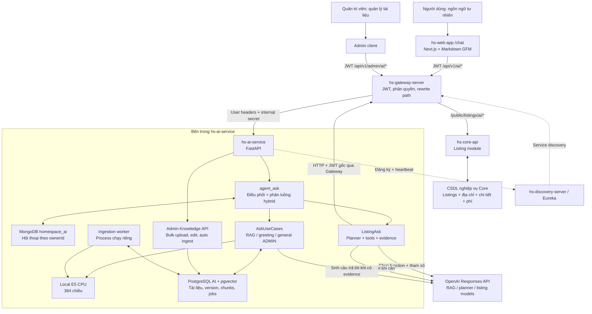
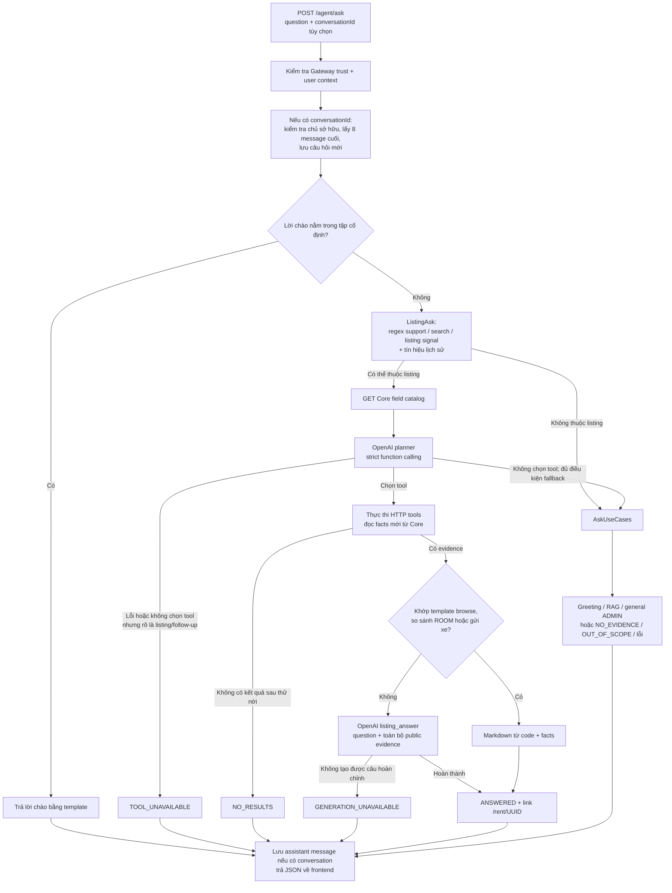
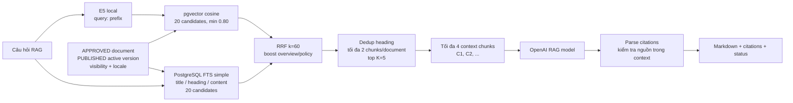
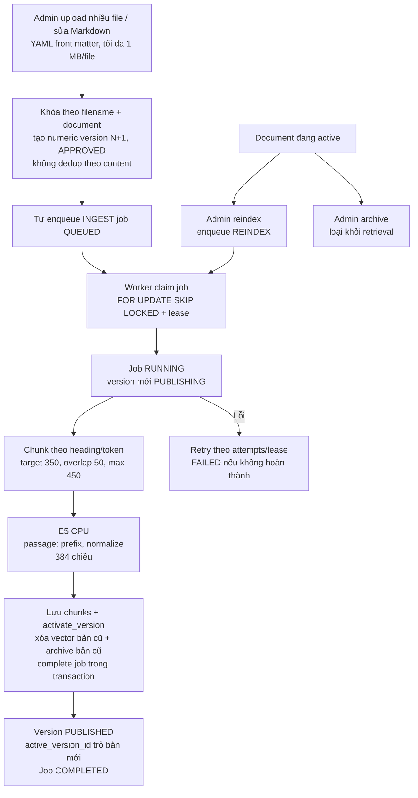

# HomeSpace AI — sơ đồ hệ thống và bộ nhớ context

> Cập nhật: **11/10/2026**. Đối chiếu source code hiện có trong workspace, bao gồm thay đổi local chưa commit. Đây là tài liệu context bền vững của dự án, không phải xác nhận trạng thái triển khai production hay memory toàn cục của AI.
>
> Khi tiếp tục công việc, đọc file này trước, rồi đối chiếu lại code/config nếu chúng đã thay đổi. Không dùng các đề xuất kiến trúc cũ làm bằng chứng rằng một tính năng đã triển khai.

## 1. Các quyết định hiện tại cần giữ

- AI có hai nguồn dữ liệu độc lập: **tài liệu đã duyệt cho RAG** và **tin đăng công khai đọc trực tiếp qua Core API**.
- Người thuê có thể tìm phòng bằng ngôn ngữ tự nhiên, hỏi chi tiết và so sánh các tin thuộc `ROOM`, `APARTMENT`, `HOUSE`. Tiện ích và nội thất bàn giao là hai nhóm riêng, không được đánh đồng.
- AI service không kết nối trực tiếp CSDL nghiệp vụ của Core và không cho model tự viết/chạy SQL. Model chọn tool và tham số; Core kiểm tra rồi thực thi truy vấn có kiểm soát.
- Generation và native function calling dùng **OpenAI Responses API**. Không còn provider/fallback Gemini hoặc Groq trong luồng generation hiện tại.
- Embedding vẫn chạy local bằng E5 trên CPU; không chuyển tài liệu sang OpenAI embedding, không cần re-embed chỉ vì đổi model generation.
- Phân bổ model hiện tại ưu tiên tiết kiệm: RAG dùng `gpt-4o-mini`; planner và câu trả lời listing dùng `gpt-4.1-mini`.
- Giữ nguyên evidence công khai sau whitelist bảo vệ dữ liệu. Không bổ sung bước cắt field/compact JSON listing để giảm payload. Điều này **không có nghĩa** context/output/rate limit của provider là vô hạn.
- Chưa có tool truy vấn hợp đồng, thanh toán, hóa đơn hoặc lịch hẹn cá nhân; chưa có tool ghi dữ liệu nghiệp vụ.
- Admin RAG hỗ trợ upload nhiều file và sửa Markdown trên giao diện. Mỗi lần upload/lưu tạo version mới theo tên file, kể cả cùng nội dung; tự queue ingestion. Bản cũ chỉ bị xóa vector khi bản mới kích hoạt thành công; giữ metadata/lịch sử version.
- Không tự nâng model đắt hơn, không tự chạy test API trả phí, không commit/push secret. Những việc đó cần được đặt trong phạm vi yêu cầu riêng.

## 2. Sơ đồ tổng thể hiện tại



Gateway được dùng ở cả hai chiều: browser → AI và AI → Core. `PostgreSQL AI` chỉ lưu knowledge/ingestion, không phải CSDL listing. MongoDB lưu lịch sử chat, không phải kho facts realtime về listing.

## 3. Luồng một câu hỏi từ frontend đến câu trả lời



### Phân luồng thực tế, không phải router hoàn toàn do model

- `agent_ask.py` thử `ListingAsk` trước, trừ lời chào chính xác.
- Câu hỗ trợ như “HomeSpace là gì”, “cách đăng tin”, “cách đặt lịch”, “cách thanh toán”, “điều khoản sử dụng” có nhánh regex ưu tiên RAG nếu không đồng thời có tín hiệu tìm kiếm.
- Tín hiệu listing được nhận diện từ câu hiện tại hoặc hai message lịch sử gần nhất. Planner tiếp tục quyết định có chọn tool hay không.
- Nếu planner không chọn tool nhưng câu có search intent hoặc lịch sử gần có link `/rent/UUID`, trả lỗi tool an toàn thay vì lấy RAG bịa facts listing.
- Phân luồng còn phụ thuộc regex và cách diễn đạt; không được gọi đây là phân loại intent đảm bảo đúng cho mọi câu tiếng Việt.
- `GENERATION_PROVIDER=disabled` dùng disabled client: không có OpenAI generation thành công; RAG có thể retrieval nhưng trả trạng thái gián đoạn khi cần sinh đáp án.

### Contract trả về frontend

Gateway endpoint: `POST /api/v1/ai/agent/ask`; endpoint bên trong AI: `POST /agent/ask`.

```json
{
  "question": "Tìm phòng trọ ở Phú Lợi có ban công và chỗ gửi xe máy",
  "conversationId": "<conversation-id>"
}
```

`question` tối đa 1.000 ký tự; backend cũng nhận alias `query`. `conversationId` có thể bỏ để hỏi stateless; alias backend là `conversation_id`.

```json
{
  "code": 1000,
  "result": {
    "answer": "<Markdown câu trả lời>",
    "status": "ANSWERED",
    "citations": [],
    "requestId": "<request-id>"
  }
}
```

| Status | Ý nghĩa |
| --- | --- |
| `ANSWERED` | Có đáp án: greeting, listing hoặc RAG |
| `GENERAL_ANSWER` | Câu trả lời kiến thức chung dành cho ADMIN, không có nguồn HomeSpace |
| `NO_RESULTS` | Tìm listing không có kết quả phù hợp sau các bước hiện có |
| `NO_EVIDENCE` | RAG không có evidence phù hợp/đủ để trả lời |
| `OUT_OF_SCOPE` | Yêu cầu dữ liệu cá nhân/realtime ngoài các tools đang hỗ trợ |
| `TOOL_UNAVAILABLE` | Không lập/thực thi được kế hoạch listing đáng tin cậy |
| `GENERATION_UNAVAILABLE` | Có thể đã lấy được dữ liệu nhưng không tạo được đáp án hoàn chỉnh |

Không dùng “không có phòng” để thay cho lỗi provider/tool. Các lỗi HTTP xác thực, validation, conversation không tồn tại vẫn có thể xảy ra ngoài các status nghiệp vụ trên.

Frontend hiện nhận **một JSON hoàn chỉnh**, chưa dùng SSE/token streaming. `AiMarkdownMessage.tsx` dùng `react-markdown` + `remark-gfm`, hỗ trợ table có cuộn ngang và link nội bộ `/rent/UUID`; không bật parser raw HTML.

## 4. Tool calling listing và truy vấn realtime

```mermaid
sequenceDiagram
    participant W as Web app
    participant G as Gateway
    participant A as AI service
    participant O as OpenAI planner
    participant C as Core listing API
    participant D as Core database
    W->>G: POST /api/v1/ai/agent/ask + JWT
    G->>A: POST /agent/ask + trusted user headers
    A->>G: GET /api/v1/public/listings/ai/fields + JWT gốc
    G->>C: GET /public/listings/ai/fields
    C-->>A: Field registry và kiểu dữ liệu
    A->>O: Question + history + strict tool schema
    O-->>A: Một function_call hoặc không gọi tool
    A->>G: POST /api/v1/public/listings/ai/search
    G->>C: Filters whitelist + sort + limit
    C->>D: Parameterized SQL, chỉ tin công khai hợp lệ
    D-->>C: Count + IDs trong transaction tìm kiếm
    C-->>A: listingIds + total + readAt
    loop Tối đa 5 IDs, đọc tuần tự
        A->>G: GET /api/v1/public/listings/ai/UUID
        G->>C: Đọc chi tiết công khai
        C->>D: Lấy facts listing
        D-->>C: Facts
        C-->>A: Listing detail
    end
    Note over A,O: Template có thể trả trực tiếp;<br/>các câu khác gọi model listing với evidence
    A-->>W: Qua Gateway: Markdown + status + requestId
```

Đây là sequence cho tìm kiếm. Với hỏi chi tiết/so sánh UUID đã biết, sau planner sẽ đọc detail trực tiếp, không bắt buộc có bước search.

### Tool model được phép chọn

| Native function | Gateway Core endpoint | Chức năng |
| --- | --- | --- |
| Catalog do code lấy trước planner | `GET /api/v1/public/listings/ai/fields` | Danh sách field filter hợp lệ và kiểu dữ liệu |
| `search_listings` | `POST /api/v1/public/listings/ai/search` | Tìm theo filters, sort, limit |
| `get_listing_detail` | `GET /api/v1/public/listings/ai/{listingId}` | Đọc một UUID đã biết |
| `get_listing_details` | Lặp endpoint detail | Đọc 2–5 UUID để so sánh |

Không có MCP server/client trong luồng đang chạy: đây là **native OpenAI function calling + HTTP adapter**. Không mô tả module cũ `property_search` là endpoint đang dùng.

Planner dùng `strict=true`, `additionalProperties=false`, enum field lấy từ Core; `tool_choice=auto`, `parallel_tool_calls=false`. Mỗi lượt chọn tối đa **một function**, không phải agent vòng lặp tự chủ nhiều bước. Code orchestration tự mở rộng search thành nhiều detail requests.

### Quy tắc filter / SQL tại Core

- `filters`: tối đa 24 điều kiện, kết hợp bằng **AND**. Chưa có cây OR/nested expression.
- Các operator: `eq`, `ne`, `gt`, `gte`, `lt`, `lte`, `contains`; Core giới hạn operator theo kiểu, không phải field nào cũng dùng được cả bảy.
- Value planner gửi dạng string; Core chuyển sang text/number/integer/boolean/date, không nhận null filter. `contains` dùng text LIKE đã escape wildcard.
- Sort: `newest`, `price_asc`, `price_desc`, `area_asc`, `area_desc`.
- AI giới hạn kết quả tối đa 5; Core API cho limit 1–10. `total` là tổng match, không phải số detail được đưa vào đáp án.
- Core search bắt buộc `active=true`, `status=PUBLISHED`, chưa hết hạn; detail kiểm tra publication/expiry, AI kiểm tra thêm active và status.
- Identifier SQL chỉ từ registry cố định; giá trị bind bằng `NamedParameterJdbcTemplate`. Bảng quan hệ được lọc qua `EXISTS`/`NOT EXISTS`.
- Count và IDs của **một search** chạy read-only `REPEATABLE_READ`; các HTTP detail đọc sau đó không cùng transaction snapshot.
- Thiếu field không được tự coi là `false`, `0`, miễn phí hoặc không có. Query SQL null không có nghĩa phủ định.

### Phạm vi field tìm kiếm hiện có

| Nhóm | Field/nhóm field được registry hỗ trợ |
| --- | --- |
| Chung | ID, title, description, category; giá/đơn vị/tiền tệ; diện tích; đặt cọc; chu kỳ thanh toán; thuê tối thiểu; thương lượng; VAT/phí quản lý đã gồm; số xe; ngày nhận/publish/hết hạn; lượt xem |
| Địa chỉ | `province_code/name`, `ward_code/name`, `street_line`, `full_address`; không có field `district_*` trong registry hiện tại |
| `house.*` | Đất, mặt tiền/chiều dài/đường vào, số mặt tiền/tầng/phòng, sân thượng, garage, lối đi, nội thất tổng quát, pháp lý, sức chứa người/xe, phạm vi/tầng cho thuê |
| `apartment.*` | Dự án, block, mã căn, tầng/tổng tầng, số phòng, nội thất tổng quát, hướng cửa/ban công, view, sức chứa, pháp lý |
| `room.*` | Mã/tầng, WC/bếp, cửa sổ/ban công/gác, nội thất tổng quát, lối đi/giờ ra vào, đồng hồ điện/nước, sức chứa người/xe, chính sách gửi xe |
| `charge.TYPE.*` | Amount, included_in_rent, billing_method, unit, description, custom_name theo loại khoản phí |
| `amenity.*` | Boolean theo các mã cố định; `amenity.code` hỗ trợ eq/ne theo mã |
| `custom_amenity.name` | Tên tiện ích tùy chỉnh |
| `furnishing.CODE.*` | Có món đồ, số lượng, tình trạng bàn giao, tên, ghi chú theo các mã cố định; cũng có `furnishing.item_code/asset_name` |
| `media.IMAGE/VIDEO` | Kiểm tra tồn tại ảnh/video |
| `viewing.day_of_week/viewing_slot` | Ngày và khung tiếp khách của tin; không phải booking cá nhân hay số lượt đặt lịch |

Nguồn chính xác của toàn bộ registry: `hs-core-api/hs-listing-service/.../AiListingSearchService.java`. Không phải mọi nội dung trả trong detail đều có filter riêng; thêm field mới cần đồng bộ registry, DTO, planner và test.

Loại phí: `ELECTRICITY`, `WATER`, `MANAGEMENT`, `INTERNET`, `SERVICE_OR_GARBAGE`, `MOTORBIKE_PARKING`, `CAR_PARKING`, `OVERTIME_AIR_CONDITIONING`, `OTHER`.

Tiện ích boolean cố định: `WIFI`, `AIR_CONDITIONER`, `WATER_HEATER`, `REFRIGERATOR`, `WASHING_MACHINE`, `ELEVATOR`, `PARKING`, `SECURITY_24_7`, `CAMERA`, `PETS_ALLOWED`, `SWIMMING_POOL`, `GYM`.

Nội thất theo mã: `BED`, `WARDROBE`, `WORK_DESK`, `KITCHEN_SHELF`, `REFRIGERATOR`, `WASHING_MACHINE`, `WATER_HEATER`, `CURTAIN`, `FAN`, `SOFA_SET`, `DINING_SET`, `TV`, `KITCHEN_CABINET`, `COOKTOP`, `AIR_CONDITIONER`, `LIGHTING`.

### Evidence, gợi ý gần đúng và response

- `ListingTools.detail` whitelist: ID/title/description/category/status; availableFrom/area/số xe; pricing; house/apartment/room detail; amenities/customAmenities; furnishings; charges; address; viewingDays/Slots; publishedAt/expiresAt/viewCount. Media chỉ đưa số ảnh/video.
- Không đưa owner identity, audit/moderation nội bộ hoặc nội dung media đầy đủ vào model.
- Search không có IDs: thử bỏ **một** điều kiện mỗi lần, từ cuối danh sách. Không tự bỏ category hoặc province/ward code/name; dừng ở lần đầu tìm được kết quả. Chưa có geospatial/semantic nearest-match ranking.
- Có nới điều kiện thì response phải ghi rõ `relaxedFilters`, không gọi gợi ý đó là khớp đầy đủ.
- Một số câu browse, so sánh ROOM tổng quát và hỏi gửi xe có template deterministic. Câu hỏi cụ thể khác dùng listing model với JSON evidence không compact.
- Browse template còn kiểm tra câu bắt đầu “Tìm”, “Kiếm”, “Cho tôi/mình xem”; cách diễn đạt “Tôi cần tìm…” có thể dùng generation thay vì template. Không nhầm điều này với thiếu dữ liệu search.
- Chính sách ROOM `NONE/FREE/PAID`, sức chứa xe và khoản `MOTORBIKE_PARKING` là các facts khác nhau. “Có chỗ gửi xe” không đồng nghĩa “miễn phí”; “includedInRent” không đồng nghĩa khoản phí không tồn tại.
- Listing response có link `/rent/{UUID}`, không dùng citations tài liệu RAG. Code bổ sung link của evidence nếu model quên.

## 5. RAG: retrieval và tài liệu đã duyệt



- USER chỉ retrieval `visibility=public`; ADMIN thêm `admin`. `audience` là metadata, không thay thế kiểm soát visibility theo role.
- Chỉ version active được retrieval; bản draft/approved chưa publish không phải evidence sử dụng để trả lời.
- `RETRIEVAL_MIN_SIMILARITY=0.80` áp dụng vector branch; lexical candidates vẫn có thể được đưa vào hợp nhất. Không hiểu 0.80 là ngưỡng loại mọi kết quả hybrid.
- Vector query là exact cosine search trong code; không mặc định tuyên bố đã có HNSW/ANN index.
- Lời chào có template. ADMIN được hỏi chủ đề chung nếu không nhận diện là HomeSpace; nhánh này không có web browsing/tool kiểm chứng realtime.
- Yêu cầu trạng thái hợp đồng/hóa đơn/lịch hẹn/tài khoản riêng chưa có tool được trả `OUT_OF_SCOPE` theo heuristic hiện có.
- Model được yêu cầu đánh dấu nguồn `[C1]...`; code kiểm tra citation ID thuộc context và trả documentId/version/title/heading/chunkId. Có heuristic fallback khi thiếu marker, nên chưa phải kiểm chứng từng claim bằng entailment.
- Ask API hiện dựng `CitationItem` không truyền snippet từ fallback; đừng dựa vào snippet để frontend chắc chắn có đoạn trích khi generation lỗi.
- RAG chưa dùng lịch sử hội thoại làm context generation, dù endpoint có nhận conversationId và lưu messages.

## 6. Nạp tài liệu và lưu trữ



Worker là **process riêng**, API không tự chạy ingestion loop. Job polling mặc định 2 giây, lease 60 giây, tối đa 3 attempts; có heartbeat/thu hồi job RUNNING bị mất lease. Reindex chỉ chấp nhận document đang active và embedding identity phù hợp.

Publish bản mới không loại bản active cũ trước khi nạp thành công. Nếu đổi model/revision embedding, quy trình hiện tại yêu cầu upload version phù hợp; không trộn vectors khác identity.

Tên file chuẩn hóa NFC/casefold là identity; `document_id/version` trong front matter không quyết định identity/số version. Migration giữ document ID cũ và đánh số lại version 1, 2, ... theo thứ tự tạo. Editor gửi `expectedVersionId` để tránh lost update (409 nếu bản đã thay đổi). Upload batch tối đa 50 file; kết quả/lỗi độc lập từng file. README bị bỏ qua. Chỉ Admin được upload/sửa; thao tác upload/apply là chấp thuận ingest, không dựa vào `status` trong Markdown. Các route approve/publish giữ cho draft cũ/retry. Cặp worker out-of-order được kiểm tra bằng version_number trước activation; bản xử lý cũ không rollback bản active mới.

### PostgreSQL AI — bảng chính

| Bảng | Vai trò |
| --- | --- |
| `knowledge_documents` | Logical document ID, source_filename unique, metadata, visibility, status, active_version_id |
| `knowledge_document_versions` | Raw Markdown, numeric version_number unique theo document, version, hash, embedding identity, config và lifecycle |
| `knowledge_chunks` | Content, heading, metadata, chunk index/token count, vector 384 |
| `knowledge_ingestion_jobs` | INGEST/REINDEX, status, attempts, lease, worker, error |
| `worker_heartbeats` | Worker registry và heartbeat phục vụ chẩn đoán |

Version liên kết document qua `document_id`; chunks/jobs có FK tới version. `active_version_id` là tham chiếu logical ở model hiện tại, không khai báo FK tại cột này trong ORM. Không thêm quan hệ ràng buộc CSDL vào sơ đồ nếu chưa đối chiếu migration.

### MongoDB — hội thoại và giới hạn memory runtime

Collection: `ai_conversations`, database mặc định `homespace_ai`.

```text
conversation
├── _id, ownerId, title, isPinned, createdAt, updatedAt
└── messages[]
    └── id, role, content, status, createdAt
```

- Đọc/sửa/pin/xóa đều scope theo `ownerId`; index hiện có `ownerId + updatedAt`.
- Lượt hỏi lấy 8 messages trước đó; planner cắt mỗi message lịch sử tối đa 1.200 ký tự rồi thêm câu hỏi hiện tại.
- Chưa lưu structured state riêng cho filters/selectedListingIds; follow-up dựa trên text và links lịch sử. Đây không phải long-term semantic memory.
- Messages array chưa có TTL/giới hạn tổng kích thước trong repository hiện tại.
- File `SCHEMA-SYSTEM.md` này là **memory context cho kỹ sư/AI coding agent**, không phải collection chat hay nguồn facts listing của trợ lý người thuê.

## 7. Model, payload và chi phí

Các giá trị dưới đây đã đối chiếu `.env` local và defaults config ngày cập nhật; **không chứa key**.

| Tác vụ | Biến model | Model hiện tại | Output budget mặc định |
| --- | --- | --- | --- |
| RAG + general ADMIN | `OPENAI_RAG_MODEL` | `gpt-4o-mini` | `OPENAI_RAG_MAX_OUTPUT_TOKENS=4096` |
| Chọn tool / filters | `OPENAI_TOOL_MODEL` | `gpt-4.1-mini` | `OPENAI_TOOL_MAX_OUTPUT_TOKENS=4096` |
| Đáp án listing / so sánh | `OPENAI_LISTING_MODEL` | `gpt-4.1-mini` | `OPENAI_LISTING_MAX_OUTPUT_TOKENS=16384` |
| Embedding tài liệu/query | `EMBEDDING_MODEL_ID` | `intfloat/multilingual-e5-small` local | Vector 384; không gọi OpenAI embedding |

- Provider local: `GENERATION_PROVIDER=openai`. Nếu không khai báo, Settings mặc định `disabled`.
- `GENERATION_TEMPERATURE=0.2`, `GENERATION_TIMEOUT_SECONDS=90`; reasoning effort chỉ gửi cho các prefix reasoning model mà transport nhận diện. Các model mặc định hiện tại không gửi reasoning parameter.
- Embedding revision pinned: `614241f622f53c4eeff9890bdc4f31cfecc418b3`; cache mặc định `./models_cache`.
- Không có output budget đồng nghĩa input payload cap. Listing evidence không bị compact, nhưng số tin/historical messages vẫn bị giới hạn như các mục trên.
- Lượt RAG thông thường có một generation request nếu có evidence. Listing có planner request và có thể thêm listing generation; template giảm được lần generation thứ hai. Listing support bị router loại trước planner không tốn planner call.
- Lỗi mạng và HTTP 408/409/429/500/502/503/504 retry tối đa một lần ở transport; `insufficient_quota`, lỗi auth/invalid request không retry theo nhánh transient. Retry có thể tăng thời gian và chi phí.
- Generation gặp `incomplete/max_output_tokens` thử lại một lần với budget gấp đôi, trần code 32.768. Nếu vẫn lỗi thì trả `GENERATION_UNAVAILABLE`, không trả đáp án bị cắt.
- Trần retry là trần code, không đảm bảo mọi model chấp nhận. Khi đổi model phải kiểm tra output/context limit của model; retry generation và retry transport là hai lớp riêng.
- Không có fallback sang model đắt hơn/provider khác. Chưa có quota/cost accounting theo từng người dùng trong AI service.
- Log `openai_usage`: task, model, input/output/cached/reasoning tokens, response status, provider request ID. Theo dõi spend bằng usage thực tế, không suy ra giá mỗi lượt chỉ từ số câu hỏi hay balance hiển thị làm tròn.
- Requests dùng `store=false`; không được diễn giải thành cam kết zero data retention cho mọi cơ chế phía provider.

## 8. Xác thực, secrets và operational boundaries

- Frontend dùng JWT qua Gateway, không giữ `OPENAI_API_KEY` và không gọi OpenAI trực tiếp.
- Gateway xóa các user/internal headers từ request bên ngoài rồi gắn lại user context đã xác thực. AI routes nhận thêm `X-Internal-Secret`.
- AI dùng shared `GATEWAY_INTERNAL_SECRET` để xác minh trust trước khi tin `X-User-*`; yêu cầu user ID. Môi trường không-local yêu cầu secret hợp lệ; local không cấu hình secret hiện có nhánh bỏ qua trust guard. Không dùng ngoại lệ local này cho triển khai public.
- AI → Core chuyển tiếp **Authorization JWT gốc**, không sao chép arbitrary user headers. Gateway client chỉ cho `/api/v1/*`, chặn `/api/v1/ai/*` để tránh gọi vòng.
- `.env` và `.env.*` bị gitignore, ngoại trừ `.env.example`; key dùng `SecretStr`, không chép vào doc/example/tests/frontend. Không overwrite `.env` đang có bằng file example khi chạy lại.
- Transport OpenAI không log key, headers, prompt, tool bodies hay provider error bodies. **Tuy nhiên** validation error handler trong `main.py` hiện log raw request body; không được tuyên bố toàn service đã loại hết dữ liệu khách hàng khỏi log. Đây là điểm cần rà riêng trước production.
- Facts listing lấy lại ở mỗi câu hỏi có tool, không cache facts trong vector database. “Realtime” ở đây là đọc lúc request, không phải subscription, push updates hay snapshot nguyên tử của cả hội thoại.

## 9. API và bản đồ source code để tiếp tục công việc

| Qua Gateway | Trong AI service | Mục đích |
| --- | --- | --- |
| `/api/v1/ai/agent/ask` | `/agent/ask` | Endpoint hỏi đáp thống nhất |
| `/api/v1/ai/agent/conversations` | `/agent/conversations` | GET list, POST create |
| `/api/v1/ai/agent/conversations/{id}` | `/agent/conversations/{id}` | GET detail, DELETE |
| `/api/v1/ai/agent/conversations/{id}/pin` | `/agent/conversations/{id}/pin` | PATCH pin |
| `/api/v1/admin/ai/knowledge/*` | `/admin/knowledge/*` | Admin knowledge API |

Knowledge routes gồm documents CRUD được hỗ trợ, approve/publish/reindex/archive, jobs/{id}, worker-health, search diagnostic, test-ask. `test-ask` có thể dùng generation và phát sinh phí khi provider bật; không gọi tự động chỉ để đọc context.

Admin upload nhiều file: `POST /api/v1/admin/ai/knowledge/documents/batch` (multipart `files[]`, 202). Mở/sửa file: `GET/PUT /api/v1/admin/ai/knowledge/documents/{id}/content`; PUT body gồm `markdown` và `expectedVersionId`, trả version/jobId mới để poll. Không đổi frontend user chat hay contract tool calling listing.

| File/module | Trách nhiệm |
| --- | --- |
| `src/homespace_ai/main.py` | Lifespan, preload E5, Mongo init, Eureka, health endpoints |
| `src/homespace_ai/core/config.py` | Settings/env, model allocation, budgets, retrieval/worker defaults |
| `src/homespace_ai/core/security.py` | Gateway trust, user context, require_admin |
| `src/homespace_ai/api/v1/agent_ask.py` | Contract hỏi đáp, owned history, điều phối hai nhánh |
| `src/homespace_ai/api/v1/schemas.py` | Request/response, citations, conversations |
| `src/homespace_ai/application/use_cases/listing_ask.py` | Orchestration listing, relaxation, templates, generation |
| `src/homespace_ai/clients/listing_tool_planner.py` | Strict OpenAI native tools và normalization heuristic |
| `src/homespace_ai/tools/listings.py` | Core HTTP tools, UUID/public checks, whitelist evidence |
| `src/homespace_ai/clients/gateway.py` | Gọi Gateway bằng caller JWT, path guard, timeout |
| `src/homespace_ai/clients/generative.py` | Responses transport, task model, safe usage logging, retries |
| `src/homespace_ai/application/use_cases/ask_use_cases.py` | RAG/general/greeting/out-of-scope, citations |
| `src/homespace_ai/repositories/chunk_repo.py` | Vector/lexical retrieval, ACL, RRF/diversity |
| `src/homespace_ai/api/v1/admin_knowledge.py` | Admin endpoints và diagnostics |
| `src/homespace_ai/application/use_cases/document_use_cases.py` | Upload/approve/publish/reindex/archive lifecycle |
| `src/homespace_ai/knowledge/ingestion/worker.py` | Background process xử lý jobs |
| `src/homespace_ai/knowledge/ingestion/parser.py` | Markdown UTF-8 + YAML front matter validation |
| `src/homespace_ai/models/knowledge.py` | ORM knowledge/jobs/worker models |
| `src/homespace_ai/repositories/conversation_repo.py` | Mongo conversations ownership và messages |
| `src/homespace_ai/repositories/job_repo.py` | Lease/claim/retry jobs |
| `scripts/smoke_openai.py` | Smoke test provider opt-in, không phải Core E2E |

Các repo liên quan, tính từ `D:/Workspace/homespace/`:

- `hs-web-app/services/ai.service.ts`: HTTP agent/conversation client.
- `hs-web-app/app/chat/page.tsx`: gửi câu hỏi qua `aiService.ask`.
- `hs-web-app/components/chat/AiMarkdownMessage.tsx`: render Markdown/table/link.
- `hs-gateway-server/src/main/java/com/hs/gateway/HsGatewayServerApplication.java`: AI/admin/Core routes và rewrite prefixes.
- `hs-gateway-server/src/main/java/com/hs/gateway/filter/UserHeaderFilter.java`: sanitize/trusted headers.
- `hs-core-api/hs-api-service/src/main/java/com/hs/api/controller/publish/PublicListingController.java`: public AI field/search/detail endpoints.
- `hs-core-api/hs-listing-service/src/main/java/com/hs/listing/service/AiListingSearchService.java`: whitelist fields, parameterized search.
- `hs-infrastructure/postgres/`: seed fixtures; chỉ là dữ liệu để đối chiếu test, không thay thế CSDL đang chạy.

Thứ tự ưu tiên khi thông tin mâu thuẫn: **source/config đang dùng → migration/contracts/tests → tài liệu context này → README/đề xuất cũ**.

## 10. Khởi chạy, kiểm tra và các giới hạn cần nhớ

Chạy trong `D:/Workspace/homespace/hs-ai-service`, sau khi chuẩn bị `.env` và hạ tầng:

```powershell
uv sync
uv run alembic upgrade head
uv run uvicorn homespace_ai.main:app --host 0.0.0.0 --port 8084
```

Worker chạy ở terminal/process riêng:

```powershell
uv run python -m homespace_ai.knowledge.ingestion.worker
```

Test unit local/mocked:

```powershell
uv run pytest tests/unit -q
```

`scripts/smoke_openai.py --live` là opt-in có trả phí, kiểm tra provider với fixtures tổng hợp, không chứng minh Core query/facts trong CSDL hiện tại đã đúng. Test mocked cũng không chứng minh chất lượng live của model. Lần cập nhật tài liệu này không gọi OpenAI trả phí hoặc test E2E production.

API startup preload E5 trước khi đăng ký Eureka, init Mongo/index/ping; worker chạy riêng. `/health/live` kiểm tra liveness; `/health/ready` kiểm tra Postgres/Mongo và cấu hình trust ngoài local, báo Eureka degraded khi cần. Readiness không xác nhận OpenAI billing/model hay một truy vấn Core cụ thể hoạt động.

Default local endpoints: AI 8084, Gateway 8080, Eureka 8761, PostgreSQL AI 5433, MongoDB 27017; đối chiếu deployment/env trước khi dùng. Đổi `.env` cần restart service; Settings được cache.

### Chưa hoàn chỉnh / không được tự suy diễn đã có

1. Intent routing, filter normalization và template detection còn heuristic; phải test đổi chủ đề, phủ định, thay đổi sở thích và follow-up mơ hồ.
2. Chưa có structured conversation state; nhiều lượt hoặc nhiều request đồng thời có thể làm context lựa chọn listing không rõ.
3. Một function mỗi lượt, tối đa 5 detail; chưa có pagination tool hoặc tự lặp lấy toàn bộ kết quả.
4. Nới điều kiện chỉ bỏ một filter, không có tính khoảng cách “quanh tôi”, không có thuật toán xếp hạng nearest match.
5. Không phải mọi field detail đều searchable; không có filter district hoặc OR tree.
6. Citation validation chưa kiểm chứng đúng/sai từng claim; listing generation vẫn cần eval chống suy diễn facts/missing data.
7. Full public evidence vẫn chịu context/token/rate limits; retry không giải quyết được mọi input payload quá lớn và có thể tăng phí.
8. Không có SSE, chưa có private account tools, không có nghiệp vụ đặt lịch/thanh toán tự động từ AI.
9. Logging validation body và Mongo messages array chưa giới hạn cần đánh giá riêng về privacy/vận hành.
10. Tài liệu này không là chỉ thị triển khai các mục còn thiếu; chỉ ghi nhận trạng thái để tránh AI agent tự thêm tính năng ngoài yêu cầu.

## 11. Context ngắn để đưa cho AI agent lần sau

> HomeSpace AI hiện là FastAPI service sau Gateway/Eureka. Endpoint hỏi đáp thống nhất `/api/v1/ai/agent/ask` điều phối hybrid regex + native OpenAI tool planner. Listing tools read-only gọi Core qua Gateway bằng JWT người hỏi; Core whitelist field/operator và parameterized SQL, chỉ tin active/PUBLISHED/chưa hết hạn. Hỗ trợ ROOM/APARTMENT/HOUSE, tiện ích, nội thất, phí, địa chỉ và thông tin tiếp khách theo registry; chưa hỗ trợ dữ liệu cá nhân hợp đồng/hóa đơn/thanh toán. RAG dùng tài liệu APPROVED + active PUBLISHED trong PostgreSQL AI/pgvector, E5 multilingual-e5-small local CPU 384 chiều, hybrid vector/FTS/RRF. Admin bulk upload/edit theo filename, mỗi lần tăng version kể cả nội dung trùng; tự enqueue worker job → chunk/embed → activate version và xóa vectors cũ trong cùng transaction, giữ lịch sử version. Worker chạy riêng; lỗi cập nhật không làm mất bản active. MongoDB lưu owned chat history; planner chỉ dùng 8 messages cuối, chưa có structured listing state. OpenAI Responses: RAG gpt-4o-mini; tool/listing gpt-4.1-mini. Không có Gemini/Groq fallback, không chuyển embedding sang OpenAI, không compact public listing evidence. Template có thể tránh lần generation thứ hai; output budgets và retries vẫn hữu hạn. Frontend render Markdown GFM/table, nhận JSON không streaming. Giữ secrets trong env ignored, không chạy paid test/commit/push nếu chưa thuộc yêu cầu. Trước khi sửa, kiểm tra source thực tế và không mô tả tính năng chưa có là đã triển khai.
